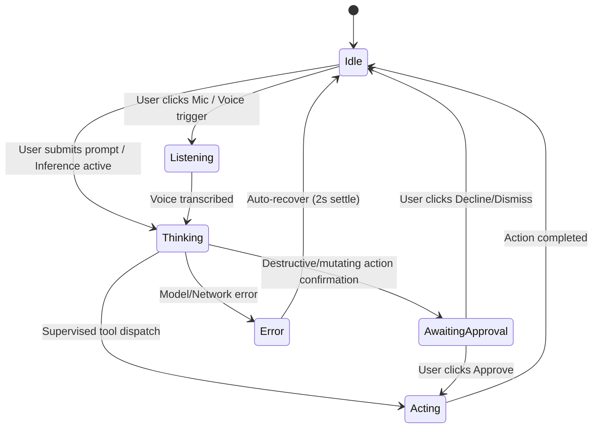

# MACL Living Intelligence: Procedural Mascot & Motion System

> **Subsystem:** `sentient_linux.gui.mascot` & `sentient_linux.gui.pill`  
> **Aesthetic:** Official Sentient OS Silhouette + MACL Living Motion  
> **Date:** October 2026  

---

## 1. Mascot Architecture: Reconstructing the Upstream Mark

The official Sentient OS mark (`SpinningLogo.swift` and `Orb.swift`) is composed of three concentric elements:

```
          ┌──────────────────────────────────────────────┐
          │   1. Outer Spectrum Band (GlowHalo.stops)    │
          │      Warm Gold → Orange → Red → Pink →       │
          │      Purple → Indigo → Blue → Seam Wrap      │
          │   ┌──────────────────────────────────────┐   │
          │   │   2. Razor-Thin Shape Ring (White)   │   │
          │   │   ┌──────────────────────────────┐   │   │
          │   │   │  3. Planet Core + Heart Glow │   │   │
          │   │   │     Brilliant White Dot      │   │   │
          │   │   └──────────────────────────────┘   │   │
          │   └──────────────────────────────────────┘   │
          └──────────────────────────────────────────────┘
```

In the MACL Living Intelligence implementation, this mark is enhanced with procedural physics and state-reactive behaviors:

### Exact Mathematical Proportions
- **Canvas Size ($S$):** 28 logical px in collapsed pill; 36 logical px in expanded header.
- **Planet Core Diameter:** $0.36 \times S$ (vector crisp white circle).
- **Core Additive Glow:** $0.50 \times S$ (radial fade with $0.6$ opacity).
- **Shape Ring Thickness:** $\max(0.75, 0.028 \times S)$.
- **Spectrum Ring Width:** $0.17 \times S$, rendered sharp and saturated.
- **Soft Ambient Bloom:** $0.22 \times S$, Gaussian/radial falloff.

---

## 2. Living Intelligence State Machine

The mascot transitions smoothly between six operational states driven directly by the `CommandCoordinator` and inference pipeline:



### Visual Behaviors by State

1. **Idle:**
   - **Period:** 13.0 seconds per complete spectrum rotation.
   - **Harmonic Breathing:** 5.5-second sinusoidal cycle ($A = \sin(2\pi t / 5.5)$), smoothly expanding the outer halo radius by $\pm 3.5\%$.
   - **Luminosity:** Subtle gentle glow variations; completely calm, non-distracting.
2. **Listening:**
   - **Rhythm:** Particle motes oscillate gently; heart glow expands to $0.60 \times S$.
   - **Audio Reactivity:** When speech input is active, amplitude pulses the core luminosity.
3. **Thinking:**
   - **Period:** Accelerates to 2.0 seconds per rotation (matching upstream `.processing` mode).
   - **Halo Intensity:** Saturated bloom intensifies from $0.25$ to $0.65$.
   - **Constellation Shift:** Small orbital micro-wobbles convey high-bandwidth cognitive work.
4. **Acting:**
   - **Directional Pulse:** Ring energy surges clockwise; edge glow along the pill sweeps across the perimeter.
   - **Progress Cue:** Confirms live tool execution under supervision.
5. **Awaiting Approval:**
   - **Color Shift:** Spectrum smoothly shifts toward warm amber (`#ffc371`, `Theme.Ink.amber`).
   - **Pulse:** Slow rhythmic amber pulse alerting the operator that confirmation is required before proceeding.
6. **Error:**
   - **Interruption:** Brief disturbance in rotation with soft crimson pulse (`#ff5c5c`, `Theme.Ink.red`).
   - **Settling:** Smoothly dampens back into calm idle state within 1.5 seconds.

---

## 3. Motion Timing & Reduced-Motion Mode

| Interaction | Standard Timing | Reduced-Motion Mode (`low_power=True`) |
|---|---|---|
| **Hover swell** | 120 ms spring | 100 ms linear fade |
| **Pill Expansion** | 350 ms spring (`response 0.52`, `damping 0.72`) | 200 ms opacity cross-fade |
| **Pill Collapse** | 250 ms cubic-bezier | 150 ms opacity cross-fade |
| **Spectrum Spin (Idle)** | 13.0 s wall-clock | Static gradient (0% CPU) |
| **Spectrum Spin (Thinking)** | 2.0 s wall-clock | Gentle 1 Hz breathing pulse |

Wall-clock timestamping ensures that animations never drop frames or stutter when CPU usage spikes during local LLM prompt evaluation.
