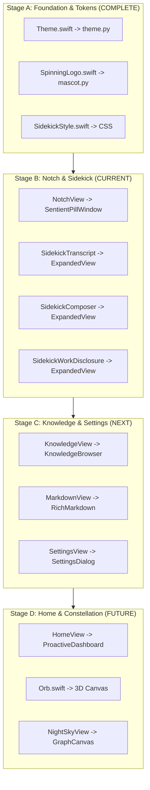

# Sentient OS Upstream UI Source Inventory

> **Document:** `docs/upstream_ui_inventory.md`  
> **Source Repository:** `https://github.com/Sentient-OS-Labs/sentient-os`  
> **Target Platform:** Arch Linux / Omarchy running Hyprland (Wayland)  
> **Directive:** Stage A — Exhaustive Upstream UI Audit  

---

## 1. Inventory Summary & Taxonomy

The official Sentient OS macOS implementation contains **74 distinct UI view files** across 9 functional categories. This inventory catalogs every view, window controller, and custom shape to serve as the strict specification for our source-driven Linux port.

```text
Sentient OS UI Architecture
├── 1. Notch & Dynamic Island Overlay (Notch Magic/)
├── 2. Sidekick Assistant & Conversation (Sidekick/)
├── 3. Home Proactive Intelligence Surface (HomeView.swift)
├── 4. Living Brand Assets & Mascots (Orb.swift, SpinningLogo.swift)
├── 5. Knowledge Vault & Constellation Graph (Knowledge/)
├── 6. Settings & Configuration Panes (Settings/)
├── 7. Onboarding & First-Run Flow (Onboarding/)
├── 8. Permissions & Diagnostic Panels (Permissions/, Diagnostics/)
└── 9. Shared Tokens & Base Materials (Theme.swift, GlowButton.swift)
```

---

## 2. Component-by-Component Catalog

### Category 1: Notch & Dynamic Island Overlay (`Notch Magic/`)

#### 1.1 `NotchView`
- **Original Path:** `Sentient OS macOS/Notch Magic/NotchView.swift`
- **Component Name:** `NotchView` / `NotchContent`
- **Purpose:** Morphing Dynamic Island overlay anchored to the screen notch. Displays spinning brand mark, live task status, serif read-back caption, and stop control.
- **Dependencies:** `CommandCoordinator`, `NotchShape`, `SpinningLogo`, `Theme`
- **Visual Behavior:** Pure OLED black capsule with smooth radius changes (top: 8px, bottom: 8-18px). Fluidly morphs width and height across phases (`hidden`, `opening`, `typing`, `listening`, `running`, `recovery`, `message`).
- **Interaction Behavior:** Click-to-type, microphone button to speak, stop button during execution. Pass-through for non-interactive areas.
- **Linux Equivalent:** Floating Wayland Layer Shell window (`Gtk4LayerShell`, `Layer.TOP`, `Edge.BOTTOM` or `Edge.TOP`).
- **Porting Complexity:** High
- **Porting Status:** Partially Ported (Bottom pill prototype active)

#### 1.2 `NotchWindowController`
- **Original Path:** `Sentient OS macOS/Notch Magic/NotchWindowController.swift`
- **Component Name:** `NotchWindowController`
- **Purpose:** AppKit window controller managing NSPanel level (`.popUpMenu`), screen geometry detection (hardware notch vs. external displays), and event passthrough.
- **Dependencies:** `AppKit`, `NSPanel`, `NSScreen`
- **Visual Behavior:** Transparent, non-activating window positioned at top-center.
- **Interaction Behavior:** Watches cursor hover, manages key window status on demand.
- **Linux Equivalent:** `gtk4-layer-shell` window lifecycle and input shape masks.
- **Porting Complexity:** Medium
- **Porting Status:** Ported (`SentientPillWindow`)

#### 1.3 `NotchShape`
- **Original Path:** `Sentient OS macOS/Notch Magic/NotchShape.swift`
- **Component Name:** `NotchShape`
- **Purpose:** Custom SwiftUI `Shape` producing continuous curvature notch with distinct top and bottom corner radii and concave shoulder fillets.
- **Dependencies:** `SwiftUI.Path`
- **Visual Behavior:** Smooth fillets merging the notch cleanly into the screen bezel.
- **Interaction Behavior:** Defines hit-test boundaries.
- **Linux Equivalent:** Cairo bezier path rendering (`cairo.Context.curve_to`) or CSS `border-radius`.
- **Porting Complexity:** Medium
- **Porting Status:** Partially Ported (Capsule radius currently in use)

#### 1.4 `SidekickNotchMessageView`
- **Original Path:** `Sentient OS macOS/Notch Magic/SidekickNotchMessageView.swift`
- **Component Name:** `SidekickNotchMessageView`
- **Purpose:** In-notch markdown message reader for quick answers without opening the full window.
- **Dependencies:** `SidekickNotchMessageLayout`, `SidekickMarkdown`
- **Visual Behavior:** Scrollable markdown text bounded within notch height (max 420px).
- **Interaction Behavior:** Scrollable; click opens full Sidekick window.
- **Linux Equivalent:** Scrolled window inside layer shell overlay.
- **Porting Complexity:** Medium
- **Porting Status:** Not Started

#### 1.5 `SidekickRecoveryView`
- **Original Path:** `Sentient OS macOS/Notch Magic/SidekickRecoveryView.swift`
- **Component Name:** `SidekickRecoveryView`
- **Purpose:** Notch dialog when agent needs operator guidance or confirmation.
- **Dependencies:** `SidekickRecoveryContent`
- **Visual Behavior:** Alert header with action chips ("Allow", "Skip", "Abort").
- **Interaction Behavior:** Button clicks dispatch to recovery state.
- **Linux Equivalent:** Action confirmation box in assistant interface.
- **Porting Complexity:** Medium
- **Porting Status:** Partially Ported (CLI supervisor confirmation active)

---

### Category 2: Sidekick Assistant & Conversation (`Views/Sidekick/`)

#### 2.1 `SidekickStyle`
- **Original Path:** `Sentient OS macOS/Views/Sidekick/SidekickStyle.swift`
- **Component Name:** `SidekickStyle`, `SidekickGlass`, `SidekickMark`, `SidekickAtmosphere`, `SidekickWorkingText`
- **Purpose:** Foundation styling for the assistant interface: colors, glass material, ambient light shapes, and shimmers.
- **Dependencies:** `Theme`, `GlowHalo`
- **Visual Behavior:** OLED black, `#ededed` white ink, `#878787` secondary, `#131313` user cards, 0.75px borders with 0.09/0.18 opacity.
- **Interaction Behavior:** Reduced motion overrides and window occlusion detection.
- **Linux Equivalent:** `sentient_linux.gui.theme` tokens and GTK4 CSS.
- **Porting Complexity:** Medium
- **Porting Status:** Ported (`theme.py`)

#### 2.2 `SidekickTranscript`
- **Original Path:** `Sentient OS macOS/Views/Sidekick/SidekickTranscript.swift`
- **Component Name:** `SidekickTranscript`, `SidekickMessageRow`
- **Purpose:** Full conversation history, empty state hero, paging controls, and search results.
- **Dependencies:** `SidekickConversationStore`, `SidekickMarkdown`, `SidekickWorkDisclosure`
- **Visual Behavior:** Empty state hero (`A little help. A lot more possible.` with illuminated mark). Right-aligned user bubbles (`#131313`, 18px radius, 58px left margin). Left-aligned transparent assistant markdown.
- **Interaction Behavior:** Auto-scroll on new messages, copy message, reply to message.
- **Linux Equivalent:** `Gtk.ScrolledWindow` with message row widgets in `expanded_view.py`.
- **Porting Complexity:** High
- **Porting Status:** Ported (`expanded_view.py`)

#### 2.3 `SidekickComposer`
- **Original Path:** `Sentient OS macOS/Views/Sidekick/SidekickComposer.swift`
- **Component Name:** `SidekickComposer`
- **Purpose:** Message input capsule at the bottom of the assistant window.
- **Dependencies:** `SidekickStyle`, `GlowHalo`, `CommandCoordinator`
- **Visual Behavior:** 18px glass capsule. 36×36 circular send button with disabled state, active state with blurred conic glowing halo, and running stop state.
- **Interaction Behavior:** Return to send, Shift-Return for newline, Escape to cancel.
- **Linux Equivalent:** `sidekick-composer` container with `Gtk.Entry` and circular send button.
- **Porting Complexity:** Medium
- **Porting Status:** Ported (`expanded_view.py`)

#### 2.4 `SidekickWorkDisclosure`
- **Original Path:** `Sentient OS macOS/Views/Sidekick/SidekickWorkDisclosure.swift`
- **Component Name:** `SidekickWorkDisclosure`
- **Purpose:** Live collapsible card displaying active agent reasoning steps, tools executed, and elapsed execution time.
- **Dependencies:** `SidekickStyle`, `SidekickWorkingText`
- **Visual Behavior:** Glass card (`rgba(255, 255, 255, 0.035)`), spinning icon, status line, and elapsed timer (`0.0s`).
- **Interaction Behavior:** Click to expand/collapse individual steps.
- **Linux Equivalent:** `sidekick-work-disclosure` box with GLib timer callback.
- **Porting Complexity:** Medium
- **Porting Status:** Ported (`expanded_view.py`)

#### 2.5 `SidekickMarkdown`
- **Original Path:** `Sentient OS macOS/Views/Sidekick/SidekickMarkdown.swift`
- **Component Name:** `SidekickMarkdown`
- **Purpose:** Rich markdown renderer supporting code blocks with syntax highlighting, wikilinks, quotes, and lists.
- **Dependencies:** Markdown parser
- **Visual Behavior:** `#ededed` body text, monospace code blocks with subtle borders, sky blue `#6fb6ff` links.
- **Interaction Behavior:** Text selection, code copy button, clickable links.
- **Linux Equivalent:** Pango markup or GTK4 markdown renderer widget.
- **Porting Complexity:** High
- **Porting Status:** Partially Ported (Plaintext/Pango formatting currently active)

#### 2.6 `SidekickClearChatButton`
- **Original Path:** `Sentient OS macOS/Views/Sidekick/SidekickClearChatButton.swift`
- **Component Name:** `SidekickClearChatButton`
- **Purpose:** Toolbar action with confirmation to wipe history.
- **Visual Behavior:** Trash/broom icon button with hover highlight.
- **Interaction Behavior:** Click shows confirmation; clears transcript store.
- **Linux Equivalent:** `sidekick-tool-btn` in header toolbar.
- **Porting Complexity:** Low
- **Porting Status:** Ported (`expanded_view.py`)

---

### Category 3: Brand Assets & Mascot Implementations (`Views/`, `Notch Magic/`)

#### 3.1 `SpinningLogo` (The Notch / Assistant Mascot)
- **Original Path:** `Sentient OS macOS/Notch Magic/SpinningLogo.swift`
- **Component Name:** `SpinningLogo`
- **Purpose:** The authentic 2D Sentient brand mark used in the notch, assistant header, and app icon.
- **Dependencies:** `GlowHalo.stops`, `TimelineView`
- **Rendering Technique:** Procedural SwiftUI vector drawing.
  - Saturated spectrum band: stroke width `size * 0.17` with saturated gold seam `#f7b23d`.
  - Neon bloom: stroke width `size * 0.22`, blur `size * 0.14`.
  - White shape ring: `max(0.75, size * 0.028)`.
  - Lit heart: width `size * 0.50`, blur `size * 0.07`, opacity 0.6.
  - Central planet core: width `size * 0.36`.
  - Continuous spin: 13s idle, 2s fast running.
- **Linux Equivalent:** Cairo procedural drawing in `LivingMascot` (`src/sentient_linux/gui/mascot.py`).
- **Porting Complexity:** Medium
- **Porting Status:** Ported (`mascot.py`)

#### 3.2 `Orb` (The 3D Living Orb)
- **Original Path:** `Sentient OS macOS/Views/Orb.swift`
- **Component Name:** `Orb`, `OrbMark`
- **Purpose:** Large brand centerpiece for the empty home surface. Dark glassy sphere, white glowing heart, 3D Keplerian tilted particle ring, and ambient halo.
- **Dependencies:** `SplitMix64`, SwiftUI `Canvas`, `FocusThrottledTimeline`
- **Rendering Technique:** Two depth-sorted Canvases sandwiching the planet sphere, with 5.5s harmonic breathing cycle.
- **Linux Equivalent:** Cairo multi-layer canvas or OpenGL/Shader widget.
- **Porting Complexity:** Very High
- **Porting Status:** `OrbMark` ported; full 3D canvas not started.

#### 3.3 `GlowHalo`
- **Original Path:** `Sentient OS macOS/Views/GlowButton.swift`
- **Component Name:** `GlowHalo`
- **Purpose:** Conic gradient halo sequence: Gold `#fde2a3` → Orange `#ff8e3c` → Red `#ff4646` → Pink `#e8388f` → Purple `#9b48d4` → Indigo `#6c5ce5` → Blue `#4a90e2` → wrap.
- **Linux Equivalent:** `THEME.spectrum_stops` and Cairo conical gradient simulation.
- **Porting Complexity:** Low
- **Porting Status:** Ported (`theme.py`)

---

### Category 4: Home & Proactive Surface (`Views/HomeView.swift`)

#### 4.1 `HomeView`
- **Original Path:** `Sentient OS macOS/Views/HomeView.swift`
- **Component Name:** `HomeView`
- **Purpose:** Primary application canvas. Displays proactive morning briefing cards, central Orb, command bar, and quick actions.
- **Dependencies:** `BriefingDeck`, `BriefingCard`, `Orb`, `PromptBar`, `SidekickComposer`
- **Visual Behavior:** Minimalist OLED black canvas with cards spread or centered Orb.
- **Interaction Behavior:** Click card to inspect or trigger computer-use action; command bar at foot.
- **Linux Equivalent:** Full standalone window or expanded desktop dashboard.
- **Porting Complexity:** Very High
- **Porting Status:** Not Started

#### 4.2 `BriefingCard`
- **Original Path:** `Sentient OS macOS/Views/BriefingCard.swift`
- **Component Name:** `BriefingCard`
- **Purpose:** Proactive recommendation cards ("Should I send this email?", "Prepare meeting brief").
- **Dependencies:** `Briefing`, `Theme.Ink`
- **Visual Behavior:** Dark slate card (`#0c0c0f`), verdict color tag, summary text, action button.
- **Linux Equivalent:** Custom glass card widget.
- **Porting Complexity:** Medium
- **Porting Status:** Not Started

#### 4.3 `PromptBar`
- **Original Path:** `Sentient OS macOS/Views/PromptBar.swift`
- **Component Name:** `PromptBar`
- **Purpose:** Fixed command bar at bottom of home screen.
- **Dependencies:** `OrbMark`, `GlowButton`
- **Visual Behavior:** Glass pill with prompt text field and action trigger.
- **Linux Equivalent:** Bottom command entry.
- **Porting Complexity:** Low
- **Porting Status:** Not Started

---

### Category 5: Knowledge Vault & Graph (`Views/Knowledge/`)

#### 5.1 `KnowledgeView`
- **Original Path:** `Sentient OS macOS/Views/Knowledge/KnowledgeView.swift`
- **Component Name:** `KnowledgeView`
- **Purpose:** Local markdown vault browser. Sidebar folder tree + dual-pane document reader.
- **Dependencies:** `VaultTree`, `MarkdownView`, `NightSkyView`
- **Visual Behavior:** Moonlit slate sidebar (`#0e0f12`), OLED black reading pane, sky blue wikilinks.
- **Interaction Behavior:** File navigation, search, wikilink click-through, star favorites.
- **Linux Equivalent:** GTK4 / QML split-view document browser.
- **Porting Complexity:** High
- **Porting Status:** Backend active (`knowledge/storage.py`); UI not started.

#### 5.2 `NightSkyView`
- **Original Path:** `Sentient OS macOS/Views/Knowledge/Graph/NightSkyView.swift`
- **Component Name:** `NightSkyView`, `SkyRenderer`
- **Purpose:** 3D interactive force-directed graph visualizing knowledge notes as constellations in a night sky.
- **Dependencies:** `SkyGraph`, `SkySimulation`, SwiftUI `Canvas`
- **Visual Behavior:** Glowing star nodes connected by faint constellation lines, physics-based drift.
- **Interaction Behavior:** Pan, zoom, node click to open note.
- **Linux Equivalent:** Cairo interactive graph canvas or OpenGL graph widget.
- **Porting Complexity:** Very High
- **Porting Status:** Not Started

---

### Category 6: Settings & Preferences (`Views/Settings/`)

#### 6.1 `SettingsView`
- **Original Path:** `Sentient OS macOS/Views/Settings/SettingsView.swift`
- **Component Name:** `SettingsView`
- **Purpose:** Multi-tab application configuration window.
- **Sub-panes:**
  - `FrontierModelPane`: Select Claude / OpenAI / Local Ollama models.
  - `ConnectorsSection`: Connect Gmail, Google Calendar, Slack, WhatsApp, Notion.
  - `DoubleTapPane`: Configure quick-assist hotkey.
  - `HealthPane`: System diagnostic health checks.
  - `ProactivePane`: Morning briefing timing and wake schedule.
  - `SourcesPane`: Folder selection for indexing.
  - `SystemPane`: Data retention, memory limits, and reset.
  - `PrivacyPolicyView`: Privacy Constitution and local storage guarantees.
- **Linux Equivalent:** GTK4 `Adw.PreferencesWindow` or tabbed settings dialog.
- **Porting Complexity:** High
- **Porting Status:** Backend settings active (`SecurityPolicy`, `PermissionManager`); UI not started.

---

### Category 7: Onboarding & First-Run Flow (`Views/Onboarding/`)

#### 7.1 `OnboardingView`
- **Original Path:** `Sentient OS macOS/Views/Onboarding/OnboardingView.swift`
- **Component Name:** `OnboardingView`, `OnboardingWindowLayout`
- **Purpose:** First-run wizard guiding user through model setup, local folders, and permissions.
- **Sub-views:**
  - `OnboardingPlanView`: Free vs. Pro tier selection.
  - `OnboardingModelDownloadView`: Local weights download progress.
  - `OnboardingPermissionsView`: Accessibility and screen capture permission setup.
  - `OnboardingReadyView`: Setup complete celebration.
- **Linux Equivalent:** Sequential wizard window.
- **Porting Complexity:** Medium
- **Porting Status:** Not Started

---

## 3. Implementation Phasing Strategy


